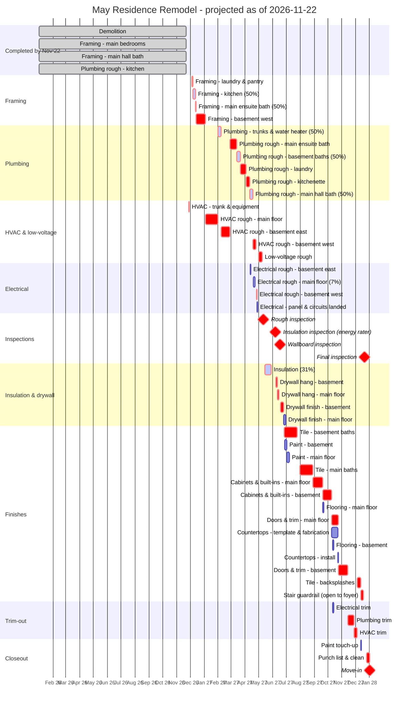

# May Residence Remodel - Schedule

<!-- GENERATED by gen/generate.py from schedule.yaml - do not edit by hand. -->

Status as of **Sun Nov 22, 2026**. Dates after that are projections.

| Milestone | Projected |
|---|---|
| Rough inspection | Tue May 11, 2027 |
| Insulation inspection (energy rater) | Mon Jun 7, 2027 |
| Wallboard inspection | Thu Jun 17, 2027 |
| Final inspection | Tue Dec 21, 2027 |
| Move-in | Sat Jan 1, 2028 |

Interactive view with room-by-room checklists: `docs/index.html`.

## Remaining work by crew

| Crew | Work days remaining |
|---|---|
| Owner | 105.6 |
| Electrical crew | 14.1 |
| Drywall crew | 13.6 |
| Paint crew | 9.9 |
| Flooring crew | 6.0 |

## Tasks

Critical-path tasks (the chain that sets the move-in date) are marked **bold**.

| ID | Task | Crew | Done | Days left | Start | Finish |
|---|---|---|---|---|---|---|
| `demo_all` | Demolition | Owner | 100% | 0 |  | done |
| `fram_main_beds` | Framing - main bedrooms | Owner | 100% | 0 |  | done |
| `fram_main_n_bath` | Framing - main hall bath | Owner | 100% | 0 |  | done |
| `fram_main_s_bath` | **Framing - main ensuite bath** | Owner | 50% | 0.7 | Sat Dec 12, 2026 | Sun Dec 13, 2026 |
| `fram_main_kitchen` | **Framing - kitchen** | Owner | 50% | 1.05 | Sun Dec 6, 2026 | Sat Dec 12, 2026 |
| `fram_main_laundry` | **Framing - laundry & pantry** | Owner | 0% | 1.75 | Sat Dec 5, 2026 | Sun Dec 6, 2026 |
| `fram_bsmt_west` | **Framing - basement west** | Owner | 0% | 6.48 | Sun Dec 13, 2026 | Sun Jan 3, 2027 |
| `plum_house` | **Plumbing - trunks & water heater** | Owner | 50% | 1.5 | Sun Jan 31, 2027 | Sun Feb 7, 2027 |
| `plum_main_kitchen` | Plumbing rough - kitchen | Owner | 100% | 0 |  | done |
| `plum_main_n_bath` | **Plumbing rough - main hall bath** | Owner | 50% | 1.62 | Sun Apr 11, 2027 | Sun Apr 18, 2027 |
| `plum_main_s_bath` | **Plumbing rough - main ensuite bath** | Owner | 0% | 3.75 | Sat Feb 27, 2027 | Sat Mar 13, 2027 |
| `plum_main_laundry` | **Plumbing rough - laundry** | Owner | 0% | 2.75 | Sun Mar 21, 2027 | Sat Apr 3, 2027 |
| `plum_bsmt_baths` | **Plumbing rough - basement baths** | Owner | 50% | 3.75 | Sat Mar 13, 2027 | Sun Mar 21, 2027 |
| `plum_bsmt_kitchenette` | **Plumbing rough - kitchenette** | Owner | 0% | 2.75 | Sat Apr 3, 2027 | Sun Apr 11, 2027 |
| `hvac_house` | **HVAC - trunk & equipment** | Owner | 0% | 2 | Sat Nov 28, 2026 | Sun Nov 29, 2026 |
| `hvac_main` | **HVAC rough - main floor** | Owner | 0% | 8 | Sun Jan 3, 2027 | Sun Jan 31, 2027 |
| `hvac_bsmt_east` | **HVAC rough - basement east** | Owner | 0% | 5 | Sun Feb 7, 2027 | Sat Feb 27, 2027 |
| `hvac_bsmt_west` | **HVAC rough - basement west** | Owner | 0% | 2.5 | Sun Apr 18, 2027 | Sun Apr 25, 2027 |
| `lowv_all` | **Low-voltage rough** | Owner | 0% | 3.25 | Sat May 1, 2027 | Sun May 9, 2027 |
| `elec_main` | Electrical rough - main floor | Electrical crew | 7% | 4.05 | Mon Apr 19, 2027 | Fri Apr 23, 2027 |
| `elec_bsmt_east` | Electrical rough - basement east | Electrical crew | 0% | 2.75 | Mon Apr 12, 2027 | Wed Apr 14, 2027 |
| `elec_bsmt_west` | **Electrical rough - basement west** | Electrical crew | 0% | 1.85 | Mon Apr 26, 2027 | Tue Apr 27, 2027 |
| `elec_panel` | Electrical - panel & circuits landed | Electrical crew | 0% | 1.5 | Tue Apr 27, 2027 | Thu Apr 29, 2027 |
| `insp_rough` | **Rough inspection** | inspection |  |  | Tue May 11, 2027 | Tue May 11, 2027 |
| `insl_all` | **Insulation** | Owner | 31% | 4.5 | Sat May 15, 2027 | Sat May 29, 2027 |
| `insp_insl` | **Insulation inspection (energy rater)** | inspection |  |  | Mon Jun 7, 2027 | Mon Jun 7, 2027 |
| `dryw_hang_main` | **Drywall hang - main floor** | Drywall crew | 0% | 1.78 | Fri Jun 11, 2027 | Tue Jun 15, 2027 |
| `dryw_hang_bsmt` | **Drywall hang - basement** | Drywall crew | 0% | 3.22 | Tue Jun 8, 2027 | Fri Jun 11, 2027 |
| `insp_board` | **Wallboard inspection** | inspection |  |  | Thu Jun 17, 2027 | Thu Jun 17, 2027 |
| `dryw_fin_main` | Drywall finish - main floor | Drywall crew | 0% | 3.06 | Fri Jun 25, 2027 | Wed Jun 30, 2027 |
| `dryw_fin_bsmt` | **Drywall finish - basement** | Drywall crew | 0% | 5.52 | Fri Jun 18, 2027 | Fri Jun 25, 2027 |
| `pant_main` | Paint - main floor | Paint crew | 0% | 3.92 | Fri Jul 2, 2027 | Thu Jul 8, 2027 |
| `pant_bsmt` | Paint - basement | Paint crew | 0% | 4 | Mon Jun 28, 2027 | Fri Jul 2, 2027 |
| `tile_main_baths` | **Tile - main baths** | Owner | 0% | 9 | Sat Jul 31, 2027 | Sat Aug 28, 2027 |
| `tile_bsmt_baths` | **Tile - basement baths** | Owner | 0% | 10 | Sat Jun 26, 2027 | Sun Jul 25, 2027 |
| `cabs_main` | **Cabinets & built-ins - main floor** | Owner | 0% | 6.5 | Sun Aug 29, 2027 | Sun Sep 19, 2027 |
| `cabs_bsmt` | **Cabinets & built-ins - basement** | Owner | 0% | 5 | Sun Sep 19, 2027 | Sat Oct 9, 2027 |
| `ctop_fab` | Countertops - template & fabrication | wait |  |  | Sat Oct 9, 2027 | Sat Oct 23, 2027 |
| `ctop_install` | Countertops - install | wait |  |  | Sat Oct 23, 2027 | Sun Oct 24, 2027 |
| `tile_backsplash` | **Tile - backsplashes** | Owner | 0% | 2 | Sun Dec 5, 2027 | Sun Dec 12, 2027 |
| `flor_main` | Flooring - main floor | Flooring crew | 0% | 2.92 | Mon Sep 20, 2027 | Wed Sep 22, 2027 |
| `flor_bsmt` | Flooring - basement | Flooring crew | 0% | 3.08 | Mon Oct 11, 2027 | Thu Oct 14, 2027 |
| `trim_main` | **Doors & trim - main floor** | Owner | 0% | 5.22 | Sat Oct 9, 2027 | Sun Oct 24, 2027 |
| `trim_bsmt` | **Doors & trim - basement** | Owner | 0% | 5.52 | Sun Oct 24, 2027 | Sun Nov 14, 2027 |
| `rail_stair` | **Stair guardrail (open to foyer)** | Owner | 0% | 1.5 | Sun Dec 12, 2027 | Sun Dec 19, 2027 |
| `plum_trim` | **Plumbing trim** | Owner | 0% | 3.5 | Sun Nov 14, 2027 | Sat Nov 27, 2027 |
| `elec_trim` | Electrical trim | Electrical crew | 0% | 3.95 | Mon Oct 11, 2027 | Thu Oct 14, 2027 |
| `hvac_trim` | **HVAC trim** | Owner | 0% | 3 | Sat Nov 27, 2027 | Sun Dec 5, 2027 |
| `insp_final` | **Final inspection** | inspection |  |  | Tue Dec 21, 2027 | Tue Dec 21, 2027 |
| `pant_touchup` | Paint touch-up | Paint crew | 0% | 2 | Mon Dec 13, 2027 | Tue Dec 14, 2027 |
| `punch_clean` | **Punch list & clean** | Owner | 0% | 3 | Sat Dec 25, 2027 | Sat Jan 1, 2028 |
| `mile_movein` | **Move-in** | milestone |  |  | Sat Jan 1, 2028 | Sat Jan 1, 2028 |
