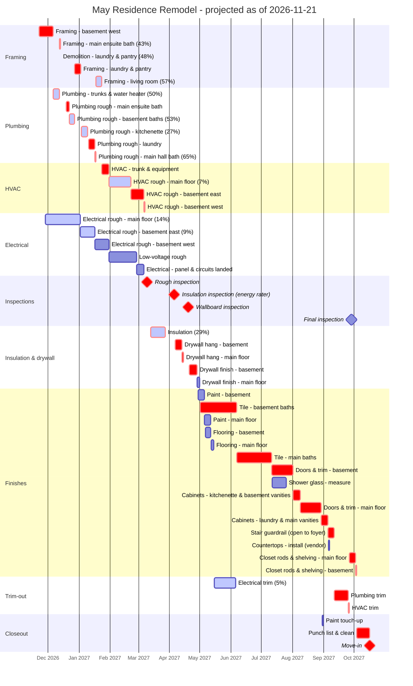

# May Residence Remodel - Schedule

<!-- GENERATED by gen/generate.py from schedule.yaml - do not edit by hand. -->

Status as of **Sat Nov 21, 2026**. Dates after that are projections.

| Milestone | Projected |
|---|---|
| Rough inspection | Tue Mar 9, 2027 |
| Insulation inspection (energy rater) | Mon Apr 5, 2027 |
| Wallboard inspection | Mon Apr 19, 2027 |
| Final inspection | Tue Sep 28, 2027 |
| Move-in | Sat Oct 16, 2027 |

Interactive view with room-by-room checklists: `docs/index.html`.

## Remaining work by crew

| Crew | Work days remaining |
|---|---|
| Owner | 92.3 |
| Electrical crew | 18.4 |
| Drywall crew | 15.4 |
| Paint crew | 10.4 |
| Flooring crew | 6.4 |

## Tasks

Critical-path tasks (the chain that sets the move-in date) are marked **bold**.

| ID | Task | Crew | Done | Days left | Start | Finish |
|---|---|---|---|---|---|---|
| `demo_all` | Demolition - all other areas | Owner | 100% | 0 |  | done |
| `demo_main_laundry` | **Demolition - laundry & pantry** | Owner | 48% | 0.65 | Sun Dec 13, 2026 | Sun Dec 13, 2026 |
| `fram_main_beds` | Framing - main bedrooms | Owner | 100% | 0 |  | done |
| `fram_main_n_bath` | Framing - main hall bath | Owner | 100% | 0 |  | done |
| `fram_main_s_bath` | **Framing - main ensuite bath** | Owner | 43% | 0.8 | Sat Dec 12, 2026 | Sun Dec 13, 2026 |
| `fram_main_kitchen` | Framing - kitchen | Owner | 100% | 0 |  | done |
| `fram_main_laundry` | **Framing - laundry & pantry** | Owner | 0% | 1.75 | Sun Dec 27, 2026 | Sat Jan 2, 2027 |
| `fram_main_living` | **Framing - living room** | Owner | 57% | 0.9 | Sun Jan 17, 2027 | Sat Jan 23, 2027 |
| `fram_bsmt_west` | **Framing - basement west** | Owner | 0% | 8.05 | Sun Nov 22, 2026 | Sun Dec 6, 2026 |
| `plum_house` | **Plumbing - trunks & water heater** | Owner | 50% | 1.5 | Sun Dec 6, 2026 | Sat Dec 12, 2026 |
| `plum_main_kitchen` | Plumbing rough - kitchen | Owner | 100% | 0 |  | done |
| `plum_main_n_bath` | **Plumbing rough - main hall bath** | Owner | 65% | 1.12 | Sat Jan 16, 2027 | Sun Jan 17, 2027 |
| `plum_main_s_bath` | **Plumbing rough - main ensuite bath** | Owner | 0% | 3.75 | Sat Dec 19, 2026 | Tue Dec 22, 2026 |
| `plum_main_laundry` | **Plumbing rough - laundry** | Owner | 0% | 1.5 | Sun Jan 10, 2027 | Sat Jan 16, 2027 |
| `plum_bsmt_baths` | **Plumbing rough - basement baths** | Owner | 53% | 3.5 | Tue Dec 22, 2026 | Sun Dec 27, 2026 |
| `plum_bsmt_kitchenette` | **Plumbing rough - kitchenette** | Owner | 27% | 2 | Sun Jan 3, 2027 | Sat Jan 9, 2027 |
| `hvac_house` | **HVAC - trunk & equipment** | Owner | 0% | 2 | Sat Jan 23, 2027 | Sat Jan 30, 2027 |
| `hvac_main` | **HVAC rough - main floor** | Owner | 7% | 7 | Sat Jan 30, 2027 | Sun Feb 21, 2027 |
| `hvac_bsmt_east` | **HVAC rough - basement east** | Owner | 0% | 3 | Sun Feb 21, 2027 | Sat Mar 6, 2027 |
| `hvac_bsmt_west` | **HVAC rough - basement west** | Owner | 0% | 1 | Sat Mar 6, 2027 | Sun Mar 7, 2027 |
| `lowv_all` | Low-voltage rough | Electrical crew | 0% | 3.25 | Sat Jan 30, 2027 | Sat Feb 27, 2027 |
| `elec_main` | Electrical rough - main floor | Electrical crew | 14% | 5.07 | Sat Nov 28, 2026 | Sat Jan 2, 2027 |
| `elec_bsmt_east` | Electrical rough - basement east | Electrical crew | 9% | 2.6 | Sat Jan 2, 2027 | Sat Jan 16, 2027 |
| `elec_bsmt_west` | Electrical rough - basement west | Electrical crew | 0% | 2.3 | Sat Jan 16, 2027 | Sat Jan 30, 2027 |
| `elec_panel` | Electrical - panel & circuits landed | Electrical crew | 0% | 1.5 | Sat Feb 27, 2027 | Sat Mar 6, 2027 |
| `insp_rough` | **Rough inspection** | inspection |  |  | Tue Mar 9, 2027 | Tue Mar 9, 2027 |
| `insl_all` | **Insulation** | Owner | 29% | 5 | Sat Mar 13, 2027 | Sat Mar 27, 2027 |
| `insp_insl` | **Insulation inspection (energy rater)** | inspection |  |  | Mon Apr 5, 2027 | Mon Apr 5, 2027 |
| `dryw_hang_main` | **Drywall hang - main floor** | Drywall crew | 0% | 1.43 | Tue Apr 13, 2027 | Wed Apr 14, 2027 |
| `dryw_hang_bsmt` | **Drywall hang - basement** | Drywall crew | 0% | 5.06 | Tue Apr 6, 2027 | Tue Apr 13, 2027 |
| `insp_board` | **Wallboard inspection** | inspection |  |  | Mon Apr 19, 2027 | Mon Apr 19, 2027 |
| `dryw_fin_main` | Drywall finish - main floor | Drywall crew | 0% | 2.7 | Wed Apr 28, 2027 | Fri Apr 30, 2027 |
| `dryw_fin_bsmt` | **Drywall finish - basement** | Drywall crew | 0% | 6.18 | Tue Apr 20, 2027 | Wed Apr 28, 2027 |
| `pant_main` | Paint - main floor | Paint crew | 0% | 3.92 | Wed May 5, 2027 | Tue May 11, 2027 |
| `pant_bsmt` | Paint - basement | Paint crew | 0% | 4.5 | Thu Apr 29, 2027 | Wed May 5, 2027 |
| `tile_main_baths` | **Tile - main baths** | Owner | 0% | 9.75 | Sun Jun 6, 2027 | Sun Jul 11, 2027 |
| `tile_bsmt_baths` | **Tile - basement baths** | Owner | 0% | 11.5 | Sat May 1, 2027 | Sun Jun 6, 2027 |
| `cabs_main` | **Cabinets - laundry & main vanities** | Owner | 0% | 2 | Sun Aug 29, 2027 | Sun Sep 5, 2027 |
| `cabs_bsmt` | **Cabinets - kitchenette & basement vanities** | Owner | 0% | 2.5 | Sun Aug 1, 2027 | Sun Aug 8, 2027 |
| `ctop_install` | Countertops - install (vendor) | wait |  |  | Sun Sep 5, 2027 | Mon Sep 6, 2027 |
| `glas_showers` | Shower glass - measure | wait |  |  | Sun Jul 11, 2027 | Sun Jul 25, 2027 |
| `flor_main` | Flooring - main floor | Flooring crew | 0% | 2.92 | Wed May 12, 2027 | Fri May 14, 2027 |
| `flor_bsmt` | Flooring - basement | Flooring crew | 0% | 3.52 | Thu May 6, 2027 | Tue May 11, 2027 |
| `trim_main` | **Doors & trim - main floor** | Owner | 0% | 5.22 | Sun Aug 8, 2027 | Sun Aug 29, 2027 |
| `trim_bsmt` | **Doors & trim - basement** | Owner | 0% | 6.18 | Sun Jul 11, 2027 | Sun Aug 1, 2027 |
| `clos_main` | **Closet rods & shelving - main floor** | Owner | 0% | 1.5 | Sun Sep 26, 2027 | Sat Oct 2, 2027 |
| `clos_bsmt` | **Closet rods & shelving - basement** | Owner | 0% | 1 | Sat Oct 2, 2027 | Sun Oct 3, 2027 |
| `rail_stair` | **Stair guardrail (open to foyer)** | Owner | 0% | 1.5 | Sun Sep 5, 2027 | Sat Sep 11, 2027 |
| `plum_trim` | **Plumbing trim** | Owner | 0% | 3.5 | Sat Sep 11, 2027 | Sat Sep 25, 2027 |
| `elec_trim` | Electrical trim | Electrical crew | 5% | 3.72 | Sat May 15, 2027 | Sat Jun 5, 2027 |
| `hvac_trim` | **HVAC trim** | Owner | 0% | 1.12 | Sat Sep 25, 2027 | Sun Sep 26, 2027 |
| `insp_final` | Final inspection | inspection |  |  | Tue Sep 28, 2027 | Tue Sep 28, 2027 |
| `pant_touchup` | Paint touch-up | Paint crew | 0% | 2 | Mon Aug 30, 2027 | Tue Aug 31, 2027 |
| `punch_clean` | **Punch list & clean** | Owner | 0% | 3 | Sun Oct 3, 2027 | Sat Oct 16, 2027 |
| `mile_movein` | **Move-in** | milestone |  |  | Sat Oct 16, 2027 | Sat Oct 16, 2027 |
